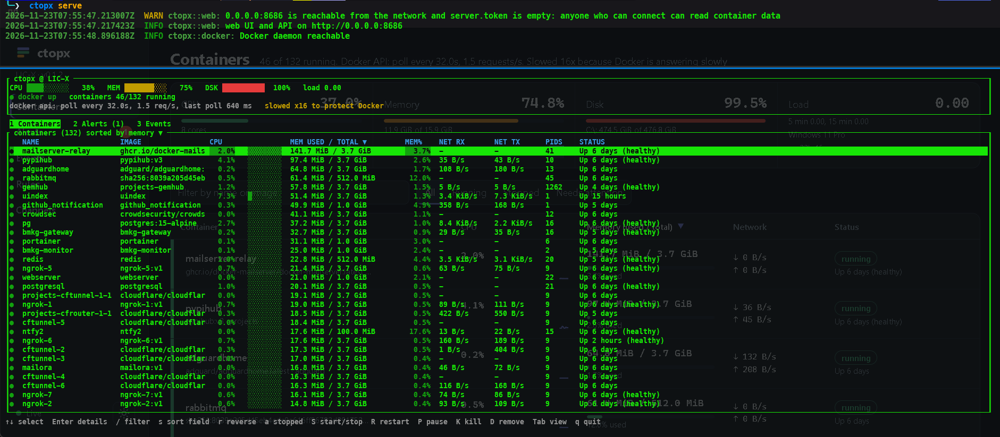
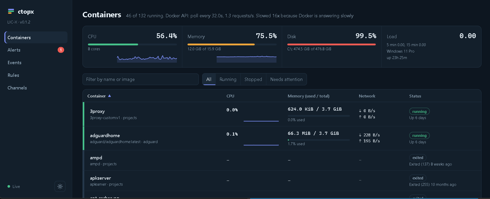

# ctopx

A `ctop`-style container monitor that also **tells you when something is wrong**. One static binary gives you:

- a terminal UI (like ctop) with per-container CPU, memory, network, disk I/O and live sparklines
- an alert engine with thresholds, sustained-duration checks, cooldowns, reminders, recovery notices and silences
- notifications to **ntfy**, **Telegram**, **GNTP** (Growl/Snarl), and **webhooks** (generic JSON with HMAC signature, Discord, Slack)
- a REST API, a live Server-Sent-Events stream and a Prometheus `/metrics` endpoint
- a modern web UI (dark and light theme) embedded in the binary: no Node, no CDN, works offline

<p align="center">
  <a href="https://raw.githubusercontent.com/cumulus13/ctopx/refs/heads/master/screenshot.png" target="_blank">
    
  </a>
</p>

<p align="center">
  <a href="https://raw.githubusercontent.com/cumulus13/ctopx/refs/heads/master/screenshot1.png" target="_blank">
    
  </a>
</p>

It monitors Docker containers and the host machine itself (CPU, memory, swap, disk, load).

## Install

Release binaries are fully static (musl) and need nothing from the system, so they run on Alpine, Debian, Termux and anything else with a Linux kernel. Pick the one that matches `uname -m`:

| `uname -m` | Binary | Typical use |
|---|---|---|
| `x86_64` | `ctopx-x86_64-musl` | Alpine, any 64-bit Linux, Termux on x86_64 |
| `aarch64`, `arm64` | `ctopx-aarch64-musl` | Alpine, Raspberry Pi 3/4/5 (64-bit), most Android phones in Termux |
| `armv7l`, `armv8l` | `ctopx-armv7-musl` | Alpine armv7, Termux on 32-bit ARM phones, Raspberry Pi 2/3 with a 32-bit OS |
| `armv6l` | `ctopx-armv6-musl` | Alpine armhf, Raspberry Pi Zero / 1 |
| `i686`, `i386` | `ctopx-i686-musl` | Alpine x86, Termux on i686 |

```sh
chmod +x ctopx-*-musl && ./ctopx-*-musl --help
```

Not sure which one? `file ctopx-*` should say "statically linked", and `uname -m` tells you the CPU. A glibc build (`cargo build --release` on a normal Linux/macOS/Windows host) will **not** run on Alpine: musl has no glibc symbols such as `__res_init`. Use the `-musl` files there.

### Termux (Android)

Docker normally does not run inside Termux, so you have two sensible setups:

```sh
# 1. Watch a remote Docker host from your phone. Use an IP address in DOCKER_HOST.
DOCKER_HOST=tcp://192.168.1.10:2375 ./ctopx-aarch64-musl

# 2. No Docker at all: watch the phone itself and get notifications.
#    Put this in ctopx.toml:   [docker]  enabled = false
./ctopx-aarch64-musl serve
```

Things that differ on Android, and what ctopx does about them:

- **DNS.** The static musl resolver needs `/etc/resolv.conf`, which Android does not have. When it is missing, notification channels use a built-in resolver that falls back to public DNS servers, and ctopx logs a warning saying so. `DOCKER_HOST` and GNTP hosts go through the normal system resolver, so use IP addresses there.
- **Certificates.** Mozilla's root certificates are built into the static binaries, so HTTPS to ntfy.sh, Telegram and similar works without a system CA bundle. For a private CA set `network.ca_file` or `SSL_CERT_FILE`.
- **Restricted `/proc`.** Recent Android versions hide parts of `/proc` from apps. If host metrics cannot be read, ctopx logs it and keeps running without them instead of crashing.
- **Config location.** `~/.config/ctopx/ctopx.toml` works, as does `ctopx init` in the current directory.

## Quick start

```sh
cargo build --release          # produces target/release/ctopx (ctopx.exe on Windows)
ctopx init                     # writes ./ctopx.toml with every option documented
ctopx check                    # validates the config and lists the rules in effect
ctopx test-notify              # sends a test message to every channel
ctopx                          # terminal UI; alerts keep working while it is open
ctopx serve                    # headless: collector + alerts + API + web UI on 127.0.0.1:8686
ctopx tui --serve              # terminal UI and web UI together
ctopx serve --allow-actions    # let the web UI and API start/stop/restart/pause/kill/remove containers
```

Or you may download a prebuilt binary from the [Releases](https://github.com/cumulus13/ctopx/releases) page

Without a config file ctopx runs with built-in rules and no channels: alerts show up in the UIs only.
Config lookup order: `--config`, `$CTOPX_CONFIG`, `./ctopx.toml`, then `%APPDATA%\ctopx\ctopx.toml` (Windows) or `~/.config/ctopx/ctopx.toml`.

ctopx connects to Docker the way the Docker CLI does (`DOCKER_HOST`, otherwise the local socket or named pipe), or use `docker.host` in the config.
If the daemon is not running when ctopx starts, it keeps retrying and reports it as an alert instead of exiting.

## What gets alerted by default

Run `ctopx check` for the exact list. Out of the box, with no configuration:

| Rule | Condition | Severity |
|---|---|---|
| container-cpu-high | CPU above 90% for 60 s | warning |
| container-memory-high / -critical | memory above 90% for 60 s / 97% for 15 s | warning / critical |
| container-crashed | die with non-zero exit code, or OOM kill | critical |
| container-unhealthy / -recovered | health check turns unhealthy / healthy | critical / info |
| container-restart-loop | 3 deaths within 5 minutes | critical |
| container-lifecycle | start, stop, restart, destroy | info |
| docker-daemon-down | Docker unreachable for 10 s | critical |
| host-cpu-high, host-memory-high | above 90% for 2 minutes | warning |
| host-disk-high | any disk above 90%; reminder every 6 h | warning |

Channels only deliver notifications at or above their `min_severity` (default `warning`), so lifecycle info events appear in the UI and TUI but do not buzz your phone unless you lower a channel to `info`. Define a rule with the same name as a built-in one to replace it, or set `alerts.use_default_rules = false`.

## Rules

```toml
[[rules]]
name = "db-cpu"
kind = "metric"              # metric | event | restart_loop | docker_daemon
metric = "cpu_percent"
op = ">"                     # > >= < <=
threshold = 80
for_secs = 120               # must stay past the threshold this long
severity = "critical"        # info | warning | critical
scope = ["postgres*"]        # container name globs; exclude = [...] also available
channels = ["phone"]         # empty = every channel
cooldown_secs = 600          # minimum gap between notifications for the same rule and subject
repeat_secs = 1800           # remind while still firing
notify_resolved = true
```

Metrics: `cpu_percent mem_percent mem_bytes net_rx_bps net_tx_bps blk_read_bps blk_write_bps pids` and for the host `host_cpu_percent host_mem_percent host_swap_percent host_disk_percent host_load1`.
Events: `start stop die crash oom restart kill pause unpause create destroy health_unhealthy health_healthy` (`crash` is a `die` with a non-zero exit code).

How alerts behave:

- A metric alert opens only after the condition holds for `for_secs`, and closes when it clears. A recovery notice is sent only if the opening notification was sent.
- If a container stops or disappears, its metric alerts close quietly.
- Cooldowns apply per rule and subject, so a flapping container does not flood you.
- Silences (UI or `POST /api/silences`) mute notifications by name glob and optionally by rule. The alert stays visible.
- Failed deliveries are retried twice (after 1 s and 4 s) and logged under Channels > Recent deliveries. One broken channel never blocks the others.

## Channels

```toml
[[channels]]
name = "phone"
type = "ntfy"                # JSON publish API, so any ntfy server works
url = "https://ntfy.sh"
topic = "my-ctopx-alerts"
token = "${NTFY_TOKEN}"      # or username / password

[[channels]]
name = "telegram"
type = "telegram"
bot_token = "${TELEGRAM_BOT_TOKEN}"
chat_id = "123456789"

[[channels]]
name = "desktop"
type = "gntp"                # Growl for Windows, Snarl, any GNTP listener
host = "127.0.0.1"
port = 23053
password = ""                # optional

[[channels]]
name = "ops"
type = "webhook"
url = "https://example.com/hook"
format = "generic"           # generic | discord | slack
secret = "${WEBHOOK_SECRET}" # adds X-Ctopx-Signature: sha256=<hex hmac of the raw body>
```

`${NAME}` in the config is replaced by the environment variable (startup fails if it is unset), so secrets stay out of the file.

Generic webhook payload:

```json
{"version":1,"instance":"host","title":"...","message":"...","severity":"critical","kind":"firing",
 "rule":"container-cpu-high","subject":"web-1","value":96.0,"timestamp":"2026-11-21T04:00:00+00:00","url":null}
```

`kind` is one of `firing`, `resolved`, `event`, `reminder`, `test`.

## Terminal UI

Each container row shows CPU with a bar, memory as `used / total` plus a percentage, network in and out, PIDs and status. The column you sort by carries an arrow (`▲` ascending, `▼` descending).

| Key | Action |
|---|---|
| `↑ ↓` / `j k`, `PgUp PgDn`, `g G` | select |
| `Enter` | details with sparklines |
| `/` | filter by name or image |
| `s` | next sort column (name, status, cpu, memory, network, pids) |
| `r` | reverse the sort direction |
| `a` | show or hide stopped containers |
| `S` | start or stop |
| `R` | restart |
| `P` | pause or resume |
| `K` | kill (SIGKILL), asks for confirmation |
| `D` | remove, asks for confirmation (Docker refuses while the container runs) |
| `Tab`, `1 2 3` | Containers, Alerts, Events |
| `q` | quit |

Actions in the TUI are on by default because you are at the machine; start with `--read-only` to disable them.
In TUI mode logs go to `ctopx.log` in the system temp directory.

## Web UI

Click a column header to sort by it; click again to reverse (arrow shows the direction). Memory is shown as `used / total`. With actions enabled there are Stop/Start and Restart buttons on every row, and the detail drawer adds Pause/Resume, Kill and Remove (the last two ask for confirmation).

Actions over HTTP (web UI and API) are **off by default**. Turn them on with `server.allow_actions = true` or `ctopx serve --allow-actions`.

## HTTP API

Everything under `/api` and `/metrics` requires `Authorization: Bearer <token>` (or `X-API-Key`, or `?token=` for the SSE stream) when `server.token` is set. `/api/health` is always open.

| Method and path | Purpose |
|---|---|
| `GET /api/state` | full snapshot: host, containers, docker status, active alerts |
| `GET /api/stream` | SSE: `snapshot` every tick, plus `alert`, `docker_event`, `delivery` |
| `GET /api/containers`, `/api/containers/{name}` | metrics (detail includes history) |
| `POST /api/containers/{name}/{start\|stop\|restart\|pause\|unpause\|kill\|remove}` | needs `server.allow_actions = true` or `--allow-actions` |
| `GET /api/history` | recent samples for sparklines |
| `GET /api/alerts`, `/api/alerts/history` | active and resolved alerts |
| `GET /api/events`, `/api/deliveries` | Docker events and notification delivery log |
| `GET /api/rules`, `/api/channels` | effective rules; channels with secrets removed |
| `POST /api/channels/{name}/test`, `POST /api/notify/test` | send a test notification |
| `GET/POST /api/silences`, `DELETE /api/silences/{id}` | manage silences |
| `POST /api/reload` | re-read the config (rules and channels; bind, token and docker settings need a restart) |
| `GET /metrics` | Prometheus text format |

## Load on the Docker daemon

`dockerd` pays for every stats request, and the cost grows with the number of containers. ctopx keeps it low:

- **Slow when idle.** With no web UI or TUI open, containers are polled every `docker.idle_interval_secs` (default 10 s) instead of `docker.interval_secs` (default 2 s). Opening a UI switches to the fast pace within a moment.
- **Only what alerts need.** With nobody watching, stats are fetched only for containers that an enabled container-metric rule can match. If you have none, no stats requests are made at all (events and the container list still work).
- **Bounded bursts.** At most `docker.max_concurrency` (default 4) stats requests run at once.
- **Self-throttling.** If a poll takes more than 40% of the interval, ctopx doubles its interval (up to 16x) and halves it again once Docker is quick. The UI and TUI header show when this happens. Disable with `docker.adaptive = false`.
- **Backoff per container.** A container whose stats keep failing or timing out is skipped for a growing delay (up to 60 s) instead of being hit every cycle.
- **Visible.** The web UI and TUI show the poll interval and Docker requests per second; `/metrics` exposes `ctopx_docker_requests_total`, `ctopx_poll_interval_seconds`, `ctopx_poll_cycle_seconds` and `ctopx_poll_throttle`.

While a UI is open the rate is roughly `running containers / interval_secs`, for example 20 requests/s for 40 containers at 2 s. If that is still too much for your host, raise `docker.interval_secs` (3 to 5 s is plenty for a dashboard) or narrow `docker.include`.

## Security

- The default bind is `127.0.0.1:8686`. Binding elsewhere without a token logs a warning.
- ctopx refuses to start if it is reachable from the network, container actions are enabled and there is no token.
- Container actions over HTTP are off by default (`server.allow_actions` or `--allow-actions`). Access to the Docker socket is effectively root on the host, so treat the token accordingly and put TLS in front (reverse proxy) if you expose the port.

## Design notes

- **actix-web, not loco**: loco brings an ORM, migrations and a project skeleton that this tool does not need. actix-web serves the API, SSE and embedded assets from one small binary.
- **Rust, single binary**: the web UI (plain HTML, CSS and JS, no build step) is embedded with `rust-embed`. TLS uses rustls with the `ring` backend, so there is no OpenSSL dependency.
- **CPU percentage** is computed from successive samples (container CPU delta over system CPU delta, as `docker stats` does) rather than Docker's `precpu` fields, which are empty in one-shot mode.
- **Memory** is usage minus page cache, matching `docker stats`.

## Limitations

- Alert history, events and silences live in memory and are lost on restart. Rules and channels live in the config file and cannot be edited from the UI.
- GNTP is sent unencrypted (`NONE`) with optional SHA256 password authentication; multi-line text is flattened to one line.
- Developed and tested on Linux (glibc and musl, x86_64). The aarch64, armv7, armv6 and i686 musl builds were run under QEMU user-mode emulation, not on real devices.
- Termux: the DNS fallback and the restricted-`/proc` handling were exercised by simulating a missing `/etc`, not on a real Android device.
- Developed and tested on Linux. The Windows code paths (Docker named pipe, Windows containers' CPU accounting) use the same libraries but have not been run on Windows yet.
- Only Docker is supported (not Podman-specific, Kubernetes or Swarm views).
- A container's notification for an OOM kill and for the crash that follows share one cooldown, so you get one message, not two.

## Development

```sh
cargo test      # unit tests: rules engine, config parsing, globbing
cargo clippy --all-targets
```

## 👤 Author
        
[Hadi Cahyadi](mailto:cumulus13@gmail.com)
    

[](https://www.buymeacoffee.com/cumulus13)

[](https://ko-fi.com/cumulus13)
 
[Support me on Patreon](https://www.patreon.com/cumulus13)
